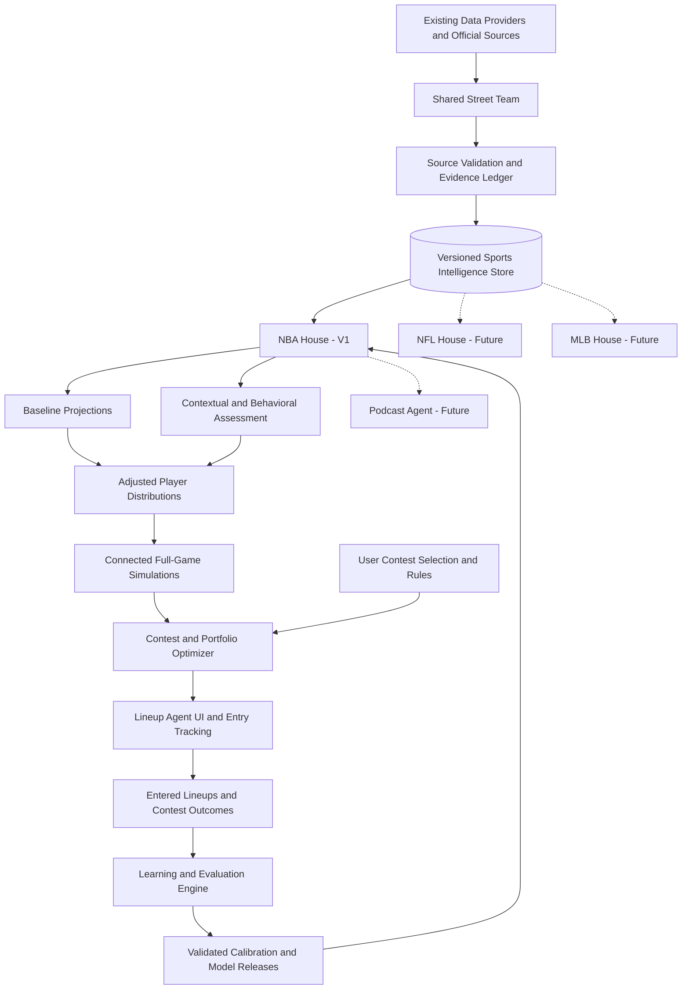

# Multi-Agent Sports Intelligence System
## Future-State Product and Operational Architecture

**Status:** Target-state design for engineering alignment  
**Initial sport:** NBA  
**Initial competition platform:** DraftKings daily fantasy sports (DFS)  
**Future expansion:** NFL, MLB, other sports, and AI podcast co-host  
**Companion document:** `Fantasy_AI_Engineering_Refactoring_Specification.md`

---

## 1. Executive Summary

Fantasy AI will evolve into a multi-agent sports intelligence platform that operates like a professional scouting and analytics organization. The system continuously discovers relevant sports information, verifies and preserves evidence, develops sport-specific projections, simulates plausible game outcomes, constructs contest-legal fantasy lineups, and evaluates actual results to improve future decisions.

The platform is **not** one language model choosing players. It is a coordinated system in which AI agents handle research, evidence interpretation, workflow orchestration, and explanation; statistical engines handle projections and uncertainty; simulation engines model connected game outcomes; and deterministic optimizers construct legal lineups and evaluate contest returns.

The business objective for DFS is to **maximize risk-aware expected net return for the selected contest and entered lineup portfolio**, not simply maximize raw fantasy points or first-place probability. The system must expose uncertainty and cannot guarantee profitability.

**Guiding principles:**

1. Reuse the existing Fantasy AI codebase, integrations, providers, database, projection engines, optimizer, simulation, evidence ledger, and learning infrastructure wherever appropriate.
2. Build **one shared Street Team** that can gather intelligence for multiple sports, but create a **separate House per sport** for modeling and decisions.
3. Complete and validate the **NBA House** before expanding to other sports.
4. Use the latest verified information while preserving prior versions and what was known at each prediction time.
5. Prioritize statistics and demonstrated predictive value; retain behavioral intelligence without automatically converting speculation into projection changes.
6. Keep operating costs low, use existing data sources first, and add model complexity only when evaluation supports it.
7. Make every lineup reproducible, explainable, legally valid for its DFS contest, and traceable to the data/model versions that produced it.

## 2. Future-State System Map

The Street Team is the common elevator serving each sport's floor. Each House uses the same shared evidence infrastructure but owns its own player assumptions, sport-specific models, simulation logic, DFS scoring rules, and learning policies.

## 3. Major Components and Responsibilities

| Component | Owns | Does not own |
|---|---|---|
| **Street Team** | Source monitoring, roster reconciliation, research assignments, provenance, fact validation, versioned observations | Fantasy-point forecasts, payout optimization |
| **Intelligence Store** | Current canonical facts, historical observations, effective timestamps, provenance, snapshots | Deciding whether a signal predicts outcomes |
| **NBA House** | NBA features, projection baselines, contextual adjustments, uncertainty, connected game simulations, analysis report | Contest UI, user entry confirmation |
| **Lineup Agent** | Contest intake, eligibility checks, optimization requests, portfolio presentation, entry tracking | Unverified player news, arbitrary scoring guesses |
| **Learning Engine** | Actual-result reconciliation, calibration, error attribution, offline tests, release recommendations | Unreviewed self-modification of production models |
| **Podcast Agent (later)** | Briefings, discussion topics, co-host preparation and interaction | Modifying prediction models or asserting speculation as fact |
| **Orchestrator** | Scheduled/event-triggered jobs, handoffs, idempotency, retries, status, cost controls | Replacing the specialist engines' decisions |

### 3.1 Shared Street Team

The Street Team is a **persistent intelligence operation**, not merely an on-demand research step triggered after choosing a DFS slate. It monitors the active sports universe, prioritizes relevant players and teams, and supplies verified evidence to each House.

**Scouting domains:** official transactions; current roster/team membership; player availability and injury timelines; projected rotations and minutes; performance history; schedule, rest and travel; game context; coaching and tactical shifts; venue and weather where sport-relevant; rivalries; players facing former teams; contract situations; verified interviews, press, and social reporting; and other potentially predictive developments.

**Research priority tiers:**

- **Active:** Eligible/current players who could materially affect tonight's rotation or slate.
- **Watchlist:** Injured, returning, recently traded, or role-sensitive players likely to become relevant.
- **Historical:** Everyone else; retained for context without consuming intensive daily research resources.

**Transaction-first rule:** Validate current team assignments and availability against authoritative sources before deeper scouting. A player traded away from a team must not remain in that team's current player pool merely because older records say otherwise.

**Evidence classifications:** confirmed official fact; corroborated report; single-source report; hypothesis/interpretation; stale or superseded item. Each item records source, retrieval time, event/effective time, sport, subject, confidence, and relevance.

**Behavioral intelligence:** The Street Team may surface a player's return from injury, former-team matchup, playoff pressure, or verified public statement. It must distinguish the **event** from any speculative claim about the player's emotions or performance. Psychological factors appear in the report even when the House applies **zero numerical adjustment**.

### 3.2 Versioned Intelligence Store

The system maintains two related views:

1. **Current state:** Best-known verified roster, injury, schedule, and other facts for operational use.
2. **Historical record:** Append-only observations and revisions, with valid/effective time and when the system learned each fact.

Example: A player is out Monday and Tuesday, then cleared Wednesday. Wednesday's current status is *available*, but the Monday–Tuesday absence remains available for recent workload and return-to-play analysis.

For every generated projection or lineup, freeze an **as-of snapshot** of the information available at that moment. Later corrections must not leak backward into historical backtests. The store should support reproducible queries such as: *What did the House know at 6:30 p.m. before Tuesday's contest locked?*

### 3.3 NBA House

The NBA House is the sport-specific analytical brain. It consumes validated Street Team intelligence and existing statistical provider data to produce calibrated player outcome distributions and slate-level scenarios.

**Modeling stages:**

1. **Validate slate and pool:** NBA schedule, current roster, active/inactive designations, eligible DraftKings players, salaries, and contest lock times.
2. **Create baseline:** Use existing affordable professional projections or current internal statistical projections; document source and timestamp.
3. **Assess adjustments:** Convert supported facts into changes in minutes, opportunity/usage, efficiency, and uncertainty. Track reason and confidence for every adjustment.
4. **Keep behavioral context separate:** Rivalry, pressure, or confidence narratives may be included as qualitative context; numerical adjustments require demonstrated evidence.
5. **Build distributions:** Model plausible range, not just a single mean fantasy-point estimate.
6. **Simulate games:** Generate correlated outcomes across all games on the selected slate, with pace, rotation, injuries, close-game/blowout/overtime scenarios, and player dependencies.
7. **Score outcomes:** Apply contest-specific DraftKings scoring rules, including relevant bonuses and roster constraints.
8. **Publish House report:** Player outlooks, uncertainty, major assumptions, scenarios, risks, evidence references, and model version.

**Simulation scope:** Prefer thousands of connected **full-game scenarios**, not independent player-point random draws. This does **not** require possession-by-possession simulation in V1. Existing simulation logic is retained and evaluated before expanding complexity.

**House outputs:** projection package; simulation run with scenario identifiers; contextual intelligence report; confidence/quality flags; traceable inputs and model versions.

### 3.4 Lineup Agent and Lineup Lab

The Lineup Agent is the primary NBA V1 presentation layer. It should feel familiar to a DraftKings or FanDuel fantasy user while remaining an independent decision-support application.

**User flow:**

1. Select sport (**NBA** in V1).
2. Select DFS platform and contest format (initially DraftKings Classic and single-game Showdown as supported by existing rules).
3. Select the **specific contest**, or supply/import contest metadata when automatic retrieval is unavailable.
4. Choose number of entries (typically one or two in ~2,000-entry contests, around four in larger ~20,000-entry contests; configurable).
5. Review field size, entry fee, prize ladder, salary cap, player pool, lock time, and roster/scoring rules.
6. Generate a lineup **portfolio** optimized for the selected payout structure and risk preferences.
7. Review each lineup, player reasons, salary, expected fantasy points, simulated cash rate, estimated expected net return, and overlap with other proposed lineups.
8. Export/copy the lineup for **manual entry** into DraftKings; mark whether each lineup was actually entered.
9. After contest completion, view score, rank, payout, net return, and learning diagnostics.

**Optimization:** The engine uses simulated player outcomes and, when defensible, an opponent field/ownership model to estimate payout outcomes. It optimizes the portfolio jointly rather than producing near-identical independent lineups by default. It should report estimates and assumptions transparently; ownership and payout estimates are not guaranteed facts.

**Contest integrity:** A lineup must satisfy the correct salary cap, positions, captain multipliers (Showdown), eligible player pool, roster size, contest rules, and timing restrictions. If payout data or opponent-field information is missing, label financial estimates unavailable or low confidence rather than inventing them; optionally optimize for projected points/upside as a clearly identified fallback.

**Entry tracking:** A *generated* lineup is not automatically an *entered* lineup. The user explicitly confirms entry; the system records contest ID, lineup version, entry fee, entry timestamp, and optional external entry identifier. Do not assume direct DraftKings account integration or automated bet placement.

### 3.5 Learning and Evaluation Engine

The learning loop compares **what was predicted at lock** with **what actually happened**, and distinguishes several failure types:

- Incorrect roster, eligibility, or injury status.
- Bad minutes/rotation assumptions.
- Player projection mean error.
- Miscalibrated variance or player correlations.
- Poor scenario probabilities (e.g., blowout rate).
- Inaccurate ownership/field estimates.
- Portfolio optimization choices or payout assumptions.

**Measurements:** player MAE/RMSE and bias; prediction interval coverage; distribution calibration; lineup legality; simulated versus observed cash rates; payout/ROI distribution; actual net returns after fees; performance by slate/contest type; and results versus an unchanged baseline.

**Learning policy:** Preserve raw evidence and frozen predictions. Run retrospective and forward/out-of-sample evaluation. Propose parameter updates, evaluate against baseline and prior production versions, then promote only changes that meet predetermined acceptance criteria. Never allow an agent to rewrite production weights after a single disappointing contest.

### 3.6 Podcast Agent — Future Phase

The podcast uses the **same Street Team and sport Houses**, but produces a different experience: daily topics, matchup narratives, verified context, competing arguments, and a conversational AI co-host. The co-host can debate predictions and ask follow-up questions while identifying opinion versus sourced fact. Podcast delivery is **not a blocker** for NBA DFS V1.

## 4. Operating Modes and Triggers

| Trigger | Action | Output |
|---|---|---|
| Scheduled recurring research | Street Team polls prioritized sources within provider limits | New evidence, roster changes, daily briefing |
| Official transaction/injury update | Reconcile affected player/team; invalidate stale affected assumptions | Revised current state and impacted House jobs |
| User selects contest | Validate contest and eligible pool; request House run | Slate-specific projection/simulation package |
| User requests regeneration | Reuse unchanged evidence when possible; recompute affected stages | Versioned alternative lineup portfolio |
| Pre-lock checkpoint | Recheck critical injury/eligibility and material changes | Freshness warnings or regenerated candidates |
| User marks entries | Freeze selected lineup and decision context | Entered-lineup record |
| Game/contest finalized | Ingest final player stats and contest results | Actual scores, placements, payout reconciliation |
| Evaluation window closes | Run diagnostics and compare baseline/challenger models | Learning report and proposed calibration changes |

**Freshness policy:** Each data class has a sport- and contest-aware TTL. A source outage or unresolved injury status is surfaced explicitly; the system must not silently substitute stale facts. Scheduled research and event-driven updates should be idempotent, rate-limited, and cost-controlled.

## 5. End-to-End NBA Showdown Example

Consider a hypothetical Warriors–Suns DraftKings Showdown:

1. The Street Team confirms the game's current rosters, recent transactions, availability, injuries, likely rotations, rest, and relevant context. Every finding is sourced and timestamped.
2. The NBA House takes current fantasy projections as baseline, adjusts minutes/opportunity where evidence warrants, and retains contextual notes such as a recent former-team matchup without automatically changing the numbers.
3. The House runs connected game simulations: close games, faster/slower pace, blowouts, overtime, and correlated player performances. It computes DraftKings fantasy scores in each scenario.
4. The user selects a Showdown contest and requests two lineups. The Lineup Agent verifies the actual Captain/Flex rules, player salaries, cap, entry fee, field size, and prize ladder.
5. The optimizer evaluates legal portfolios across simulated outcomes and plausible opponent fields. It presents two candidates with expected points, risk, estimated cash probability, expected net return (when sufficient data exists), and overlap.
6. The user manually enters one or both lineups in DraftKings and marks exactly which were entered.
7. After final results, the system records player fantasy scores, contest finish, payout, and net profit/loss. It evaluates errors and logs proposed improvements for later validation.

No real roster, salary, injury, or matchup assertions are implied by this hypothetical example.

## 6. Core Data Contracts (Conceptual)

These are **future-state logical contracts**, not a claim that the current database already has these exact tables. The companion engineering specification defines implementation-level migrations.

| Record | Required identifiers and fields |
|---|---|
| `intelligence_observation` | observation ID, sport, subject/player/team, claim, source, source timestamp, observed timestamp, effective time, classification, confidence, supersedes ID |
| `roster_state` | sport, team ID, player ID, current status, valid-from/to, evidence references |
| `intelligence_snapshot` | snapshot ID, sport, as-of time, observation/version references, freshness state |
| `house_run` | run ID, sport, slate ID, snapshot ID, model version, run time, status |
| `player_projection` | run ID, player ID, baseline mean, adjusted mean, uncertainty, adjustment reasons, source references |
| `simulation_run` | run ID, scenario count, seed, model version, scenario output location, validation status |
| `contest` | platform contest ID, slate, format, roster rules, salary cap, field size, fee, payout ladder, lock time |
| `lineup_portfolio` | portfolio ID, contest ID, House run ID, objective, number of lineups, optimizer version |
| `lineup` | lineup ID, portfolio ID, player/slot assignments, salary, predicted metrics, legality result |
| `entry` | lineup ID, contest ID, user-entered status, entry timestamp, fee, external ID if available |
| `actual_result` | player fantasy totals, contest score/rank/payout, finalization timestamp |
| `evaluation_run` | frozen prediction refs, actual refs, metrics, baseline comparison, candidate change, promotion status |

**Contract rules:** Stable IDs; sport scoping; source provenance; UTC timestamps with event-local display; immutable historical records; reproducible model/config versions; explicit missing/unknown statuses; and strict separation of predictions from realized outcomes.

## 7. Agent Handoffs and Governance

### Street Team → NBA House

**Input:** sport, monitoring priorities, active slate context (optional), source budget, prior intelligence state.  
**Output:** canonical verified facts, evidence ledger entries, changed-entity list, freshness/confidence metadata, behavioral notes, and snapshot reference.  
**Failure behavior:** Preserve prior verified state with stale warning; do not silently invent transactions or player statuses.

### NBA House → Lineup Agent

**Input:** validated slate, evidence snapshot, projection/model configuration.  
**Output:** versioned player projections, simulated outcome distribution, player eligibility, explanation/uncertainty, validation flags.  
**Failure behavior:** Block unsafe lineup generation when core eligibility or scoring rules cannot be verified; distinguish degraded modeling from invalid contests.

### Lineup Agent → Learning Engine

**Input:** frozen generated lineup, confirmed entered lineup, contest details, predictions at decision time, actual scores/payouts when finalized.  
**Output:** reconciled results, diagnostic metrics, attribution, comparison to baseline.  
**Failure behavior:** Mark results pending or incomplete; never substitute estimated winnings for confirmed payouts.

### Learning Engine → NBA House

**Input:** sufficiently large historical evaluation window, baseline/challenger comparison, candidate model changes.  
**Output:** evaluation report, recommendation, versioned candidate configuration.  
**Promotion:** Controlled release after validation; never automatic unbounded self-modification.

## 8. User Experience: Future-State Navigation

**Home / Operations:** Tonight's NBA slate, Street Team briefing, major changes, data freshness, pending decisions, latest House runs.

**Street Team:** Research feed with verified facts, player watchlists, transaction and injury timeline, source provenance, behavioral intelligence, current versus historical state.

**NBA House:** Slate selection, baseline versus adjusted projections, reasons for changes, scenario analysis, simulation status, model confidence, version comparison.

**Lineup Lab:** Contest picker/import, lineup count, objective and risk settings, generated lineup cards/roster grid, Captain/Flex validation, portfolio overlap, export and entered-status controls.

**History / Results:** Generated versus actually entered lineups, contest results, cash and net return, slate-level performance.

**Learning:** Calibration dashboards, error breakdown, baseline/challenger comparison, evidence of improvement, model version and release history.

**Podcast Studio (later):** Topics, sourced narratives, briefing scripts, AI co-host interaction.

## 9. Engineering and Operational Non-Negotiables

- Preserve existing working providers and data mappings unless a documented gap or defect requires change.
- Keep API credentials server-side; respect provider licensing, usage terms, and rate limits.
- Validate player identity and team assignment across providers; do not rely on names alone.
- Make scheduled jobs idempotent with retries, dead-letter/error tracking, and observability.
- Store data and model versions so every lineup can be reconstructed from the information available at its generation time.
- Enforce deterministic DFS rules independently of the LLM.
- Never treat unsourced social narratives as verified facts or allow them to dominate statistical evidence.
- Distinguish experimental simulations from validated production models in UI and APIs.
- Show freshness and uncertainty; block or warn appropriately when critical inputs are unavailable.
- Require explicit user confirmation of actual entries and actual financial results.
- Keep user contest data private and use least-privilege access to external services.
- Track per-provider, per-agent, and per-run operating costs.

## 10. Rollout Sequence

**Phase 0 — Baseline and regression:** Freeze current behavior, inventory reusable code, verify test fixtures and existing contracts, establish baseline model/optimizer metrics.

**Phase 1 — Shared Street Team:** Persistent monitoring, official transactions and roster reconciliation, evidence classifications, current-state views, historical snapshots, source/freshness checks.

**Phase 2 — NBA House:** Sport-specific analytical boundary, projection baselines, evidence-backed adjustments, separate behavioral commentary, reproducible run contracts.

**Phase 3 — Simulations and evaluation:** Validate existing connected-game simulations, calibrate distributions, measure improvement over simple baselines, publish validation status.

**Phase 4 — Lineup Lab:** Contest metadata, deterministic legality, Showdown/Classic support, payout-aware portfolio optimization, explanations, entry marking.

**Phase 5 — Closed-loop learning:** Actual-results ingestion, frozen as-of comparisons, attribution dashboards, controlled model promotion.

**Phase 6 — Operations and UX polish:** Reliability, monitoring, cost controls, daily briefing, clearer role-based screens and workflows.

**Future:** Additional sport Houses and podcast co-host, without disrupting the shared Street Team or NBA workflows.

## 11. NBA V1 Definition of Done

NBA V1 is complete when engineering can demonstrate all of the following:

- The Street Team continuously maintains current NBA roster/injury/transaction intelligence with sourced, timestamped historical changes.
- The NBA House generates versioned baseline and adjusted projections, preserving adjustment reasons and a behavioral section that does not invent statistical effects.
- The House produces connected game scenarios and reports measured calibration/validation status.
- A user can select a supported DraftKings NBA contest, configure entry count, and generate a portfolio of **legal** lineups under the actual contest rules.
- The system uses verified payout information when claiming payout-aware optimization, otherwise clearly identifies its fallback objective and missing inputs.
- Users can distinguish generated lineups from those they actually entered.
- Actual outcomes, payouts, and net results are reconciled after contests finish.
- The Learning Engine compares forecasts and lineup performance against frozen as-of baselines and produces actionable, auditable diagnostics.
- Existing providers and supported legacy workflows continue functioning, or intentional changes are explicitly documented.
- Reliability, freshness, source attribution, latency, cost, and model-quality metrics are observable.

**Success is not defined by a guaranteed win rate.** It is defined by a reliable, reproducible, evidence-driven pipeline that can demonstrate whether each new intelligence or modeling layer improves performance over a baseline.

## 12. Relationship to the Engineering Refactoring Specification

This document defines **what the finished system does, how components collaborate, and what users experience**. The companion `Fantasy_AI_Engineering_Refactoring_Specification.md` defines **how to transform the current repository**, including file-level changes, migrations, detailed contracts, testing, and implementation sequence. Engineering should use the two together and reconcile any naming differences against the actual codebase before implementation.
